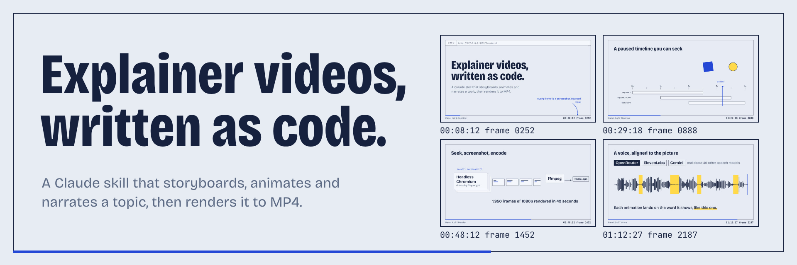
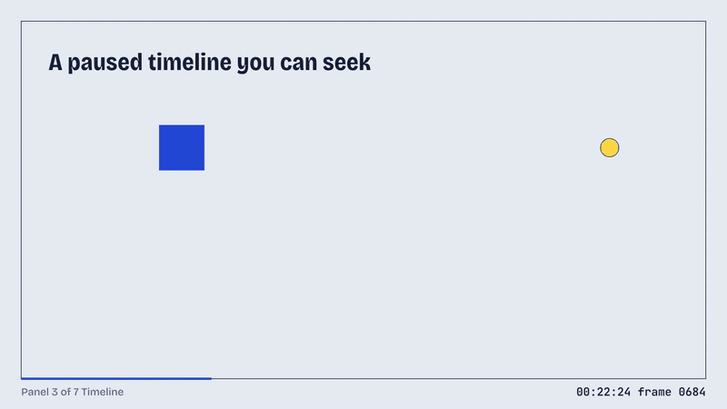

<p align="center">
  
</p>

# video-explainer-skill

A Claude skill that turns a topic into a narrated explainer video. Claude writes a storyboard, builds each scene as a small web page animated with GSAP, checks its own work, adds a voiceover, and renders everything frame by frame to MP4. No video-generation model is involved: every frame is a screenshot of a web page.

## Watch it explain itself

The video below was made with this skill, about this skill. It's 82 seconds, narrated by Gemini TTS, and rendered in 68 seconds.

https://github.com/user-attachments/assets/0d7af3d0-73de-46db-9dc3-f555367478e2

Every scene is a GSAP timeline held paused. Seeking it to any moment reproduces that frame exactly, which is what makes frame-by-frame rendering possible:

<p align="center">
  
</p>

The video's source is in [`docs/explainer/`](docs/explainer): one `video.json` storyboard, seven scene modules, and the narration clips. The banner above is a one-scene project in [`docs/header/`](docs/header), rendered as a still.

## How it works

1. **Storyboard.** Claude agrees on topic, audience and length, then writes `video.json`: one entry per scene with the narration and a description of what's on screen.
2. **Scenes as code.** Each scene is a JavaScript module that builds HTML/SVG and adds tweens to its own GSAP timeline. Helpers cover the usual explainer moves: reveals, arrows, packets moving along paths, bar charts, code walkthroughs, counters, highlighter marks.
3. **Voiceover.** Claude calls the OpenRouter MCP `generate-speech` tool once per scene. `narration.mjs` caches each clip and measures where the speech pauses. Scenes use `"duration": "auto"` to fit their audio, and `cue('phrase')` to time each animation to the moment that phrase is spoken.
4. **Self-review.** `lint.mjs` loads every scene in headless Chromium and flags load errors, elements outside the frame, clipped text, animations that overrun their scene, and stale narration. `render.mjs --contact-sheet` produces a grid of frames that Claude looks at before the final render.
5. **Render.** Playwright opens the project in headless Chromium, seeks the master timeline to `frame / fps`, screenshots it, and pipes the JPEG into ffmpeg. Four browser workers each take a slice of the frame range in parallel. The segments are concatenated and the narration clips are mixed into one track and muxed as MP3.

Because nothing runs on wall-clock time, the same project always renders the same frames, and any frame can be rendered on its own.

## What it's built on

| Piece | Used for |
|---|---|
| [GSAP](https://gsap.com) | Timelines that can be paused and seeked, plus DrawSVG, MotionPath, MorphSVG and SplitText for strokes, paths, morphs and text reveals. Free under GSAP's standard "no charge" license. |
| [Playwright](https://playwright.dev) + headless Chromium | Loads each project, drives the seekable clock, captures frames over the Chrome DevTools Protocol, and composes contact sheets. |
| [ffmpeg](https://ffmpeg.org) | Encodes frames to H.264, joins worker segments, mixes narration clips at each scene's start, converts raw PCM speech, and finds the pauses in each clip. |
| [OpenRouter MCP server](https://openrouter.ai) | Text-to-speech through one interface to about 40 speech models, including ElevenLabs, Gemini and Kokoro. No API key lives in the skill. |
| [Fontsource](https://fontsource.org) | Bundled variable fonts (Inter, JetBrains Mono, Bricolage Grotesque), so renders never depend on network fonts. |
| Node.js built-ins | A small static server and the CLI scripts; no web framework or bundler. |

## Install

Requires Node.js 20+ and ffmpeg on your `PATH`.

```bash
git clone <this repo> video-explainer-skill
cd video-explainer-skill/scripts && npm install && npx playwright install chromium

# make the skill available to Claude Code in every project
ln -s "$(cd .. && pwd)" ~/.claude/skills/video-explainer
```

For voiceovers, connect the OpenRouter MCP server once:

```bash
claude mcp add --transport http -s user openrouter https://mcp.openrouter.ai/mcp
```

## Use it

Ask Claude Code for a video, for example: *"Make a 60-second explainer on how HTTPS certificates work, with a voiceover."* The skill walks Claude through storyboard, scenes, narration, review and render.

You can also run the scripts directly:

| Command | Does |
|---|---|
| `node scripts/new.mjs <dir> --title "…"` | Scaffold a project from `templates/project/`. |
| `node scripts/serve.mjs <dir>` | Interactive preview with scrubber, narration playback, captions (`c`) and mute (`m`). |
| `node scripts/lint.mjs <dir>` | Load every scene and report layout, timing and narration problems. |
| `node scripts/narration.mjs status <dir>` | List scenes needing voiceover, with the exact `generate-speech` arguments. |
| `node scripts/narration.mjs add <dir> <scene> <file>` | Register a generated clip (MP3 or raw PCM). |
| `node scripts/render.mjs <dir> --contact-sheet` | Grid of frames across every scene, for review. |
| `node scripts/render.mjs <dir> --stills 4.5,12` | Full-size PNGs of specific moments. |
| `node scripts/render.mjs <dir>` | The final MP4. Add `--scale 0.5` for a quick draft, `--from`/`--to` for part of it, `--no-voice` for silence. |

## Repository layout

| Path | What |
|---|---|
| `SKILL.md` | What Claude reads: the workflow, the scene contract and the quality bar. |
| `reference/` | Storyboarding, visual design, animation recipes, and the voiceover procedure. |
| `runtime/` | Browser side: `runtime.js` (master timeline, seekable clock, voice alignment, preview UI), `helpers.js`, `base.css`. |
| `scripts/` | The CLI: `new`, `serve`, `lint`, `narration`, `render`, and a shared `lib/`. |
| `templates/project/` | The starting point for a new video. |
| `docs/` | This README's video and banner, as projects, plus the rendered media. |

## Notes

- A 1080p minute renders in about a minute on a laptop (four workers, ~30 frames/s).
- Audio is muxed as MP3 so renders play everywhere, including VS Code's preview. Use `--audio-codec aac` if a platform requires AAC.
- `cue()` anchors each clause boundary in the narration to a measured pause in the audio, so phrases that start a clause land on the spoken word whichever TTS model you use.
- ElevenLabs' premade voice names are due to stop working on 2026-12-31 (per the OpenRouter tool); after that the skill will need voice IDs. See `reference/voiceover.md`.
